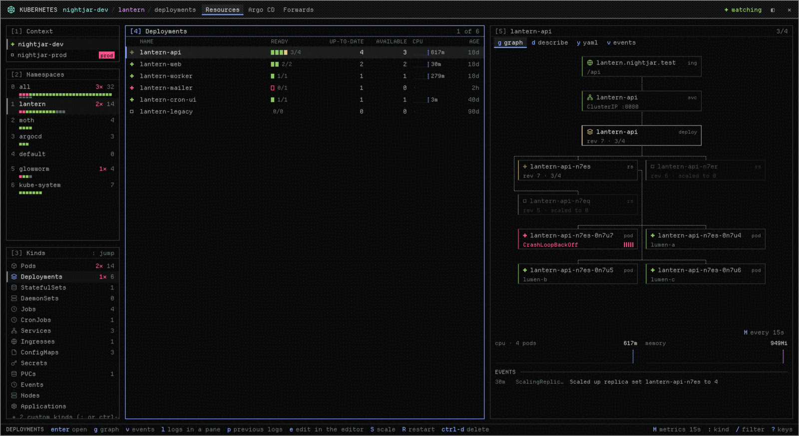
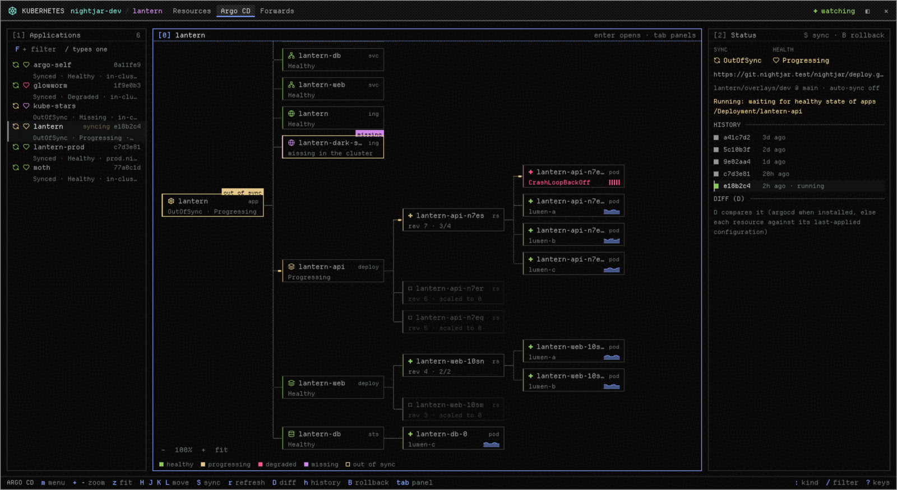
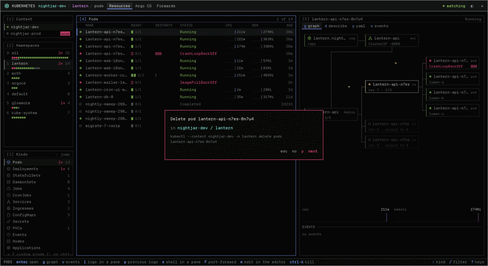
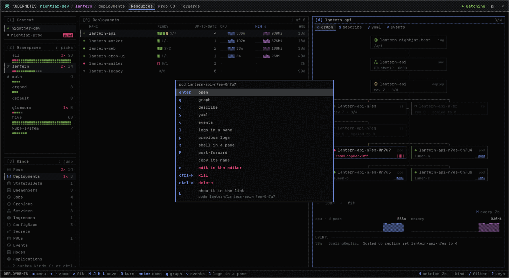
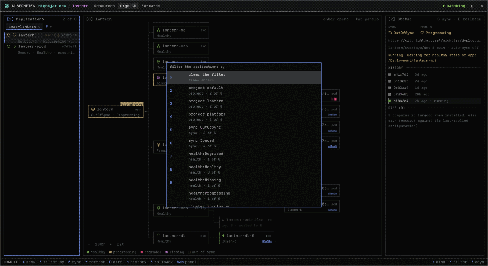

# k8s: Kubernetes and Argo CD in Fireflies

An optional mod for [Fireflies](https://github.com/DwieDave/fireflies): your
clusters in a window (or a pane) drawn in Nocturne's night look, driven by
the keyboard first and the pointer too. Its keys follow k9s's where they fit.



## What it shows

- **Where you are**: the kubeconfig's contexts (a production-looking one
  tagged `prod`, one you marked read-only tagged `ro`), the namespaces, each
  with its pods as a strip of cells (a failing pod is a red cell, counted
  beside the name, before you open it), the kinds with their counts.
- **The kind's table**: readiness as blocks, restarts as marks (bright when
  the last one was within the hour), CPU and memory (pods, deployments,
  stateful sets, nodes) as dithered lines over the readings so far with the
  value now, when the cluster runs metrics-server (without it the column
  says so once), ages as kubectl prints them. A click on a header sorts by
  what the column means (ages by time, CPU and memory by the reading now,
  restarts by count, a status failing first), again the other way, a third
  time back; drag a header's edge to resize the column (a double click fits
  it). Sorts and widths are kept per kind. The details (node, up-to-date…)
  leave a narrow table first.
- **The selected row**: its graph, read the way traffic flows (ingress →
  service → deployment → replica sets → pods, old replica sets faded), each
  pod with its CPU line and restarts; describe and YAML in a read-only code
  view; its events. In a panel taller than wide (the detail column) the
  graph runs top to bottom, a row per rank with whole names; in a wide, low
  one (under the table, a wide pane) left to right; `O` turns it. A graph
  larger than its panel drags with the pointer, or `H` `J` `K` `L`.
- **Metrics**: CPU and memory every 15 s by default; `M` (or the chip by the
  lines) reads them every 2 s, 5 s, 30 s or pauses them, kept in the
  settings. metrics-server itself measures about every 15 s: a faster read
  that answers its last numbers again adds nothing to the lines, and the
  chip says "same numbers".
- **Panels**: drag the gap between two panels to resize them (a double click
  puts it back), or `+` and `-` on the panel with the keys; the sizes are
  kept, a window's and a pane's apart.
- **Argo CD**: the applications (from the cluster's `applications.argoproj.io`
  objects: no `argocd` CLI needed), each one's resource tree as Argo's web UI
  draws it (out-of-sync and missing resources outlined and flagged), its
  status, history and diff; sync, refresh and rollback.
- **Port-forwards**: each one a terminal of its own that keeps running when
  the window closes, listed on a shelf with where it leads.



## Into the rest of the app

- `l` a pod's logs and `s` a shell in it open as terminals in panes beside,
  not inside the window (a container picker when there are several).
- `F` port-forwards a pod's, service's or deployment's port. An http port
  opens in a web pane; a database's (Postgres, MySQL: guessed from the port,
  the name and the image, and you pick) opens in the Databases window when
  that mod is installed, connected with the password from the cluster
  (below).
- `e` opens the object's YAML in the editor; when you save, the window asks
  before it applies (`kubectl replace`, so a change made meanwhile is refused,
  not overwritten).

### A database's password, from the cluster

`b` on a database forward looks for its credentials before it opens
Databases, reading objects and secrets' key names only, never a value:

- the pod behind the forward (a service's pods, a workload's template): its
  containers' env, the database images' variables (`POSTGRES_PASSWORD`,
  `POSTGRES_USER`, `POSTGRES_DB`, `PGPASSWORD`, Bitnami's
  `POSTGRES_POSTGRES_PASSWORD`, spilo's `PGPASSWORD_SUPERUSER`,
  `MYSQL_ROOT_PASSWORD`, `MYSQL_USER` / `MYSQL_PASSWORD` / `MYSQL_DATABASE`,
  the `MARIADB_` ones) as a secret's key, a secret's every key (`envFrom`,
  its prefix too), or a `*_FILE` pointing into a mounted secret (Bitnami's
  password files). A password written in the pod's spec or a config map is
  named, not passed on.
- the operators' secrets, by their labels: CloudNativePG (`<cluster>-app`,
  `<cluster>-superuser`), Crunchy PGO and Percona's PG operator
  (`<cluster>-pguser-<user>`), Zalando's postgres-operator
  (`<user>.<cluster>.credentials.postgresql.acid.zalan.do`).

One secret found: Databases opens on it and connects. Several (root and an
app user): a picker, by keys (`j` `k`, a number, `enter`) and the pointer,
each with where it was found. None: Databases asks for the password, as
before. `B` (or the forward's menu) opens the picker anyway, with any secret
of the namespace by hand: the secret, the key with the password, the key with
the user.

Before anything is read, `b` looks for the client Databases runs (psql;
mysql or mariadb) on the app's PATH. Missing, it says what installs it
("Databases needs psql to open this: brew install libpq …; on nix
pkgs.postgresql (libpq alone has no psql)") and stays; `b` again opens
Databases anyway, which also looks in the space folder's direnv environment
(a project's flake may bring its own psql).

The contract with the Databases mod:

A password in a Kubernetes secret: a Postgres or MySQL connection to a server
on this machine (`host` 127.0.0.1, localhost or ::1, as a port-forward is)
may name where a cluster keeps its password, never the password:
`"secret": {"from": "kubernetes", "context": "<kubeconfig context>",
"namespace": "<namespace>", "name": "<secret>", "key": "<the password's
key>", "userKey"?: "<the user name's key>", "databaseKey"?: "<the database's
key>", "kubectl"?: "kubectl" | "/abs/path/to/kubectl"}`. The window checks
the names (a namespace and a secret's name as Kubernetes allows them, keys of
`-._a-zA-Z0-9`, kubectl by that name only; a bad one refuses the request) and
at every connect runs the one read it builds itself, `kubectl
--context=<context> --namespace=<namespace> get secret <name>
--request-timeout=10s -o go-template=…` (each named key's base64 on a line),
decoded into its memory; a user or database read there fills `user` /
`database`. The password then goes the way every password goes (the client's
environment or a 0600 file), never an argument, shared state, props, the log,
the history or a file. The connection's row and head say where it came from
("password from secret lantern-db-auth · password (nightjar-dev/lantern),
read with kubectl"); a failed read (no access, the secret gone, kubectl
missing) or a password the server refuses says why and asks for it. Saved
(`s`), it keeps the secret's place and reads again at each connect; a
password typed in its form moves it to the keychain.

Other mods open it on a resource: `openOverlay({ mod: "k8s", kind: "window",
key: "k8s", frame: "none", scrim: true, width: 0.88, height: 0.88, props: {
context?, namespace?, kind?, name?, view? } })`, or as a pane with
`pane.split { mod: "k8s", props: { slot, ... } }`. They find it installed by
`~/.config/herdr-app/mods/k8s/mod.json`.

## Safety

- Every write asks first, naming the context and namespace. Deleting,
  killing, draining, and anything in a context whose name looks like
  production (`prod|prd|production|live`) asks twice: the second time you
  type the object's name.
- Contexts listed as read-only in the settings are never written to.
- The window passes `--context` on every call and never changes your
  kubeconfig's current context.
- Secrets are listed by their key names only (their values never leave
  kubectl); `x` shows one secret's values on its row and forgets them when you
  leave it. They're never kept anywhere.



## Install

By hand: clone it and link its `mod/` folder into Fireflies' mods.

```sh
git clone https://github.com/DwieDave/fireflies-k8s ~/code/fireflies-k8s
ln -s ~/code/fireflies-k8s/mod ~/.config/herdr-app/mods/k8s
```

To update: `git pull` in the clone; the app reloads the mod.

With nix (a flake input, linked by home-manager):

```nix
# flake.nix
inputs.fireflies-k8s = { url = "github:DwieDave/fireflies-k8s"; flake = false; };

# home-manager
xdg.configFile."herdr-app/mods/k8s".source = "${inputs.fireflies-k8s}/mod";
```

To update: `nix flake update fireflies-k8s` and switch. The folder is then read
only: Fireflies can't write its editor typings (`tsconfig.json`,
`gpui-kit.d.ts`) into it, which only matters for editing the mod there.

Fireflies loads it at once. Open it with the palette (Kubernetes) or "+ new"
(Nocturne reads the mod's `launcher` in `mod.json`: its title, icon and `"key":
"k"`, so `k` in "+ new" opens it, shift-k on the other landing; a Kubernetes
pane or tab wears the same icon and name), or bind a key in your own
`~/.config/herdr-app/keys.json`:

```json
{ "global": { "cmd-shift-k": "mod.open:k8s" } }
```

Settings, all optional, in `~/.config/herdr-app/k8s/settings.json`:

```json
{
  "kubectl": "kubectl",
  "readonly": ["my-prod-context"],
  "prod": "prod|prd|production|live",
  "favourites": ["my-app", "other"],
  "metrics": 15
}
```

## Keys

| key | what |
|---|---|
| `:` | jump to a kind (k9s's aliases: `po`, `deploy`, `svc`, `ing`, `cm`, `sec`, `no`, `ev`, `sts`, `ds`, `cj`, `pvc`, custom kinds by name; `ctx`, `pf`, `argo`) |
| `/` | filter: words in the name, `!x` not x, labels `app=web` `app!=web` (or kubectl's `-l app=web,tier,!canary`), `status:` `ns:` `node:`; every term must match. The Argo CD tab takes the same syntax. |
| `n` | namespace: a picker (type to narrow it, `0` all, `1`-`9` the first nine shown, `*` makes one a favourite; favourites first) |
| `1` `2` `3` `0` `4` | the panels by number, as in the Databases window: context, namespaces, kinds, the table, detail (Argo CD: applications `1`, tree `0`, status `2`) |
| `ctrl-a` | every kind |
| `enter` | drill in (a deployment's pods), a namespace, an app's tree |
| `g` `d` `y` `v` | graph, describe, YAML, events |
| `l` `p` `s` | logs, previous logs, shell (in panes) |
| `F` `f` | port-forward, the forwards |
| `w` | an ingress in a web pane |
| `b` `B` | a database forward in Databases, its password's secret found; picked |
| `e` | edit in the editor |
| `S` `R` | scale, restart |
| `x` | show a secret's values |
| `c` `u` `D` | cordon, uncordon, drain a node |
| `ctrl-d` `ctrl-k` | delete, kill |
| `[` `]`, `tab` `shift-tab` | the tabs; the next / previous panel |
| `+` `-` | the panel with the keys wider or narrower (or drag the gap) |
| `,` `.` | the table: the keys to the column left / right (its header underlined) |
| `o` | sort by that column: up, down, back to the default order (or click its header) |
| `{` `}` | that column narrower / wider (or drag its header's edge; a double click fits it) |
| `H` | hide that column (`O` shows hidden ones again) |
| `O` | the columns menu: sort by any column, the default order, hide, show the hidden ones, fit, wider / narrower, every width back, copy its name (or right-click a header) |
| `M` | metrics: read every 2s, 5s, 15s, 30s, or paused |
| `m` `space` | the menu of the row, rail entry, graph box, application, history entry or forward with the keys (or right-click it) |
| `*` `J` `K` | in the rail: a namespace a favourite or not; a favourite down / up (or drag it onto another) |
| `ctrl-t` | into a pane / out to a window |
| `?` | every key |

A graph (the detail panel's, Argo's tree), with the keys there: `j` `k` `h`
`l` walk the boxes the way the graph reads, `H` `J` `K` `L` move it (so does
a drag, or the wheel), `+` `-` zoom it (so do cmd-scroll and ctrl-scroll
around the pointer, and the chips at its foot; zoomed out, a box shows its
name on one line, then its kind's mark, the whole name on hover), `z` shows
the whole graph (again: 100%), `m` (or a right click on a box) opens the
box's menu: what its row offers in the list, the same entries and keys
(logs, shell, describe, YAML, edit, forward, scale, restart, delete with its
ask, copy its name), then "show it in the list"; on Argo's tree also its
application's (sync, refresh, diff, history, roll back), which a right click
on the application in the list opens too. `c` centres the selected box (or
a double click on the empty graph), `O` turns the workload graph (top to
bottom / left to right, kept), `enter` opens the box's object. Over a graph
`+` `-` zoom; the panel's size there: drag its gap.



Argo CD: `S` sync, `r` refresh (`R` hard), `D` diff, `h` history, `B` roll
back to the picked revision, `o` the repository, `m` (or a right click on
an application) its menu.

The applications filter: `/` types it (`project:` `sync:` `health:`
`cluster:` `ns:` `repo:`, labels `team=lantern`, `-l tier,!canary`, free
words; `tab` completes from what the applications have), `F` (or the
"+ filter" chip) picks from a menu of what they have with counts. The terms
show as chips over the list, a click takes one off; the list's title counts
shown / all; `esc` clears it. It's kept for the next opening.



## Development

The mod's TypeScript meets Fireflies' bar for its own mods: strict `tsc`,
oxlint with anti-slop, a file under 750 lines and a function at 80 code
lines or fewer.

```sh
bun install
just check        # typecheck, lint, size, test (what CI runs)
just types        # refresh types/gpui-kit.d.ts from the Fireflies on PATH
```

Everything is developed and tested against `test/fake/kubectl`, a fake
kubectl answering from the recorded JSON of a made-up cluster, *nightjar*
(`test/fixtures/build.ts` writes it). Writes are logged, never applied.
`test/shots.sh <herdr-app>` takes the pictures above in a scratch Fireflies.

Icons: [Lucide](https://lucide.dev) (ISC). Licence: MIT ([LICENSE](LICENSE)).
